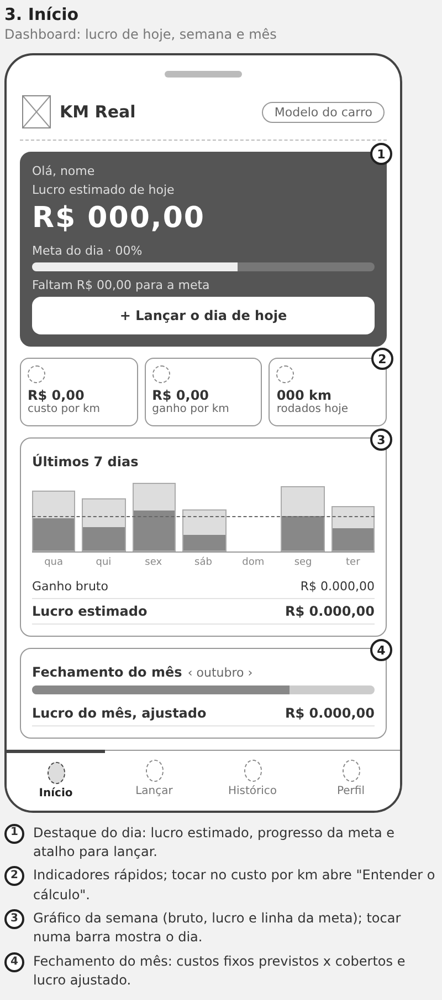
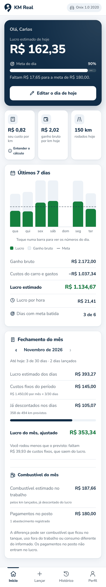
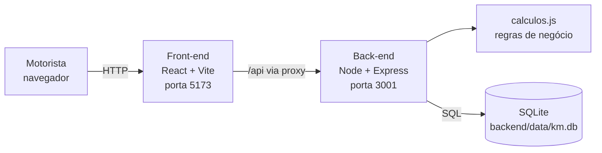
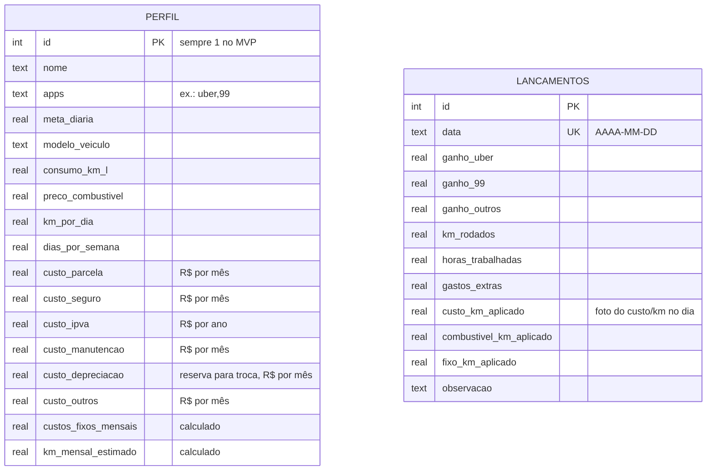

# KM Real

**Quanto sobra de verdade a cada quilômetro que você roda.**

Aplicativo de gestão financeira para motoristas de aplicativo (Uber e 99), desenvolvido pela **Quilômetro Labs** como Projeto Integrador da disciplina de Design Profissional (Universidade Positivo).

---

## O problema

O motorista vê o valor bruto de cada corrida no app, mas esse número não desconta combustível, seguro, IPVA, parcela ou aluguel do carro, manutenção e gastos do dia. Muitos acham que estão lucrando bem e, na prática, rodam perto do prejuízo.

O segmento "Gestão Financeira para Uber/99" apareceu com **92% de necessidade** na pesquisa de mercado do Prof. Sedenilso Machado (mais de 40 mil entrevistados), o maior índice entre os 15 segmentos estudados.

## A solução

O KM Real calcula o **custo real por quilômetro** do carro do motorista e, a cada dia lançado, mostra o **lucro líquido**, o progresso da **meta diária** e a evolução da semana.

## Funcionalidades do MVP

- **Cadastro inicial** em duas etapas: dados do motorista (nome, apps, meta diária) e do veículo (combustível, km por dia e dias por semana, custos fixos separados).
- **Custo real por km**, separado entre combustível e custos fixos.
- **Lançamento do dia** com ganhos por app, km rodados, horas online e gastos extras, com prévia do lucro enquanto digita.
- **Dashboard** com o lucro de hoje, o progresso da meta diária, indicadores rápidos (com "Entender o cálculo" do custo por km) e gráfico dos últimos 7 dias.
- **Layout para celular e computador**: barra de navegação inferior no celular, menu lateral e telas em duas colunas no computador.
- **Histórico** com edição e exclusão de dias lançados.
- **Perfil e veículo** editáveis, com recálculo automático do custo por km para os próximos lançamentos.

## Design

| Wireframe | Protótipo e app |
|---|---|
|  |  |

- **[Protótipo navegável no Figma](https://www.figma.com/design/WvEst2KBErrDpuNFzeXu67)**: componentes, 6 telas do celular e fluxos "Primeiro acesso" e "Uso diário".
- [Pesquisa com motoristas](docs/pesquisa.md): relatos, matriz de dores, persona e jornada.
- [Wireframes de baixa fidelidade](docs/wireframes/): estrutura das 6 telas.
- [Guia de estilo](docs/guia-de-estilo/): marca, cores, tipografia, ícones e componentes.
- [Telas em alta fidelidade](docs/telas/): prints do app no celular e no computador.
- [Requisitos](docs/requisitos.md): funcionais, não funcionais e regras de negócio.
- [Relatório final em PDF](docs/relatorio/KM-Real-Relatorio-Final.pdf): as 6 seções pedidas no enunciado.
- [Teste de usabilidade](docs/teste-de-usabilidade.md): roteiro curto com 1 ou 2 motoristas.

## Equipe

| Integrante | Função | Responsabilidades |
|---|---|---|
| Rafael e Vinicius | Product Owner | Visão do produto, prioridades, pesquisa com motoristas e pitch |
| Lucas | Desenvolvedor full-stack | Arquitetura, back-end, front-end, banco de dados e repositório |
| Lucas e Rafael | UI/UX Designer | Wireframes, identidade visual, guia de estilo e protótipo no Figma |
| Vinicius | Testador | Teste de usabilidade com motoristas e testes do app antes da entrega |

---

## Tecnologias

| Camada | Tecnologia |
|---|---|
| Front-end | React 18 + Vite 6 (JavaScript), CSS puro |
| Back-end | Node.js 22+ com Express 4 (API REST) |
| Banco de dados | SQLite, via módulo nativo `node:sqlite` |
| Orquestração | npm workspaces + concurrently |

O banco usa o SQLite embutido no próprio Node, então **não é preciso instalar nem compilar nenhum driver**. Isso evita os erros de build comuns no Windows.

## Arquitetura



O front-end nunca acessa o banco diretamente. Ele chama a API REST, que valida os dados, aplica as regras de cálculo e grava no SQLite. As regras ficam isoladas em `backend/src/calculos.js`, como funções puras.

### Estrutura de pastas

```
.
├── backend/
│   ├── data/               # arquivo km.db (criado automaticamente)
│   └── src/
│       ├── server.js       # inicializa o Express e as rotas
│       ├── db.js           # conexão e criação das tabelas
│       ├── calculos.js     # custo por km, lucro do dia, totais
│       ├── validacao.js    # validação dos dados recebidos
│       ├── seed.js         # dados de exemplo para demonstração
│       └── routes/         # perfil, lancamentos, resumo
├── frontend/
│   ├── index.html
│   ├── vite.config.js      # proxy /api -> backend
│   └── src/
│       ├── App.jsx         # navegação entre as telas
│       ├── api.js          # chamadas à API
│       ├── util.js         # formatação e prévias de cálculo
│       ├── styles.css      # identidade visual (cores, layout celular e computador)
│       ├── assets/         # logo em SVG
│       ├── components/     # KmIcon, ValorAnimado, FaixaMeta, GraficoSemana, Campo, CamposVeiculo, NavInferior
│       └── pages/          # BoasVindas, Inicio, LancarDia, Historico, Veiculo
├── docs/                   # materiais de apoio e pendências do projeto
└── package.json            # scripts da raiz (workspaces)
```

---

## Como rodar localmente

### Pré-requisitos

- **Node.js 22.13 ou mais novo** (recomendado: a versão LTS mais recente em [nodejs.org](https://nodejs.org)). Confira com `node -v`.
- Git

### Passo a passo

```bash
# 1. Clonar o repositório
git clone https://github.com/lucasMD10/Quil-metro-Labs.git
cd Quil-metro-Labs

# 2. Instalar as dependências (front e back de uma vez)
npm install

# 3. (Opcional) Popular o banco com um motorista e 2 semanas de exemplo
npm run seed

# 4. Subir front-end e back-end juntos
npm run dev
```

Depois, abra **http://localhost:5173** no navegador. A API fica em http://localhost:3001.

Sem o passo 3, o app abre na tela de cadastro inicial. Para recomeçar do zero, apague o arquivo `backend/data/km.db`.

### Abrir no celular

1. Ligue o computador e o celular **na mesma rede Wi-Fi**.
2. Rode o sistema (`npm start` ou `npm run dev`). O terminal mostra uma linha como `No celular (mesmo Wi-Fi): http://192.168.0.10:3001`.
3. Digite esse endereço no navegador do celular. Com `npm run dev`, use o endereço "Network" que o Vite mostra (porta 5173).
4. Na primeira vez, o Windows pode perguntar se o Node.js pode usar a rede: escolha **Permitir** em redes privadas.

Dica: no Chrome do celular, menu ⋮ → **Adicionar à tela inicial** cria um atalho com cara de app.

### Scripts disponíveis

| Comando | O que faz |
|---|---|
| `npm run dev` | Sobe API (3001) e front (5173) juntos |
| `npm start` | Compila o front e sobe tudo numa porta só (http://localhost:3001), sem o Vite |
| `npm run seed` | Recria o banco com dados de exemplo |
| `npm run build` | Gera a versão de produção do front em `frontend/dist` |

---

## Regras de cálculo

**Lucro, no KM Real, é a sobra no bolso:** ganhos menos tudo o que sai do bolso por causa do carro (combustível, parcela ou aluguel, seguro, IPVA, manutenção, reserva para troca do carro e outros). É uma **estimativa**: os custos fixos do mês são divididos pelos km que o motorista prevê rodar. Num mês em que ele roda menos que o previsto, o custo real de cada km é maior que o estimado.

```
custos fixos do mês = parcela/aluguel + seguro + IPVA ÷ 12 + manutenção + reserva para troca + outros
km rodados por mês  = km por dia × dias por semana × 4,33 (52 semanas ÷ 12 meses)

combustível por km = preço do litro ÷ consumo (km/l)
fixo por km        = custos fixos do mês ÷ km rodados por mês
custo real por km  = combustível por km + fixo por km

ganho bruto do dia = Uber + 99 + outros
custo do dia       = km rodados × custo real por km + gastos extras
lucro real do dia  = ganho bruto − custo do dia
```

O motorista informa cada custo fixo separado e quantos km roda num dia normal; o backend calcula o total do mês e os km do mês (`calculos.js`). Bancos criados antes desse detalhamento ganham as colunas novas automaticamente ao iniciar.

**Fechamento do mês.** Como os custos fixos são rateados pelos km previstos, o fechamento compara o que os dias lançados já descontaram com o que os custos fixos custaram no período (proporcional aos dias, contando a partir do primeiro dia lançado no app):

```
custos fixos do período = custos fixos do mês × dias do período ÷ dias do mês
diferença               = fixos descontados nos dias − custos fixos do período
lucro do mês, ajustado  = lucro estimado dos dias + diferença
```

Diferença negativa: o motorista rodou menos que o previsto e parte dos custos fixos ainda sai do lucro. Positiva: rodou mais e os dias descontaram a mais.

Cada lançamento guarda o custo por km vigente no momento (`custo_km_aplicado`, mais as partes `combustivel_km_aplicado` e `fixo_km_aplicado`). Se o preço do combustível mudar, os dias antigos não são recalculados, nem quando editados. Para usar o custo atual num dia antigo, o motorista marca "Recalcular com o custo de hoje" (a API recebe `recalcular_custo: true`).

## Modelo de dados



## API REST

| Método | Rota | Descrição |
|---|---|---|
| GET | `/api/saude` | Verifica se a API está no ar |
| GET | `/api/perfil` | Perfil + custo por km (ou `null` se não cadastrado) |
| PUT | `/api/perfil` | Cria ou atualiza o perfil |
| GET | `/api/lancamentos?de=&ate=` | Lista os dias lançados com indicadores |
| GET | `/api/lancamentos/:data` | Lançamento de um dia |
| PUT | `/api/lancamentos/:data` | Cria ou atualiza o lançamento do dia |
| DELETE | `/api/lancamentos/:data` | Exclui o lançamento do dia |
| GET | `/api/resumo?ate=&dias=7` | Hoje, meta, série diária e totais do período |
| GET | `/api/resumo/mes?mes=AAAA-MM&hoje=` | Fechamento do mês: custos fixos do período x descontados nos dias e lucro ajustado |

Erros retornam `{ "erro": "mensagem" }` com o status HTTP adequado (400, 404, 409).

---

## Próximos passos (fora do MVP)

- Importação automática de ganhos. Uber e 99 não oferecem API pública para isso hoje, então o lançamento é manual.
- Múltiplos usuários com login.
- Simulador de corrida: "essa corrida compensa?" antes de aceitar.
- Alertas de manutenção por quilometragem.
- Versão instalável no celular (PWA).

---

Quilômetro Labs · Projeto Integrador · Design Profissional · Universidade Positivo · 2026
