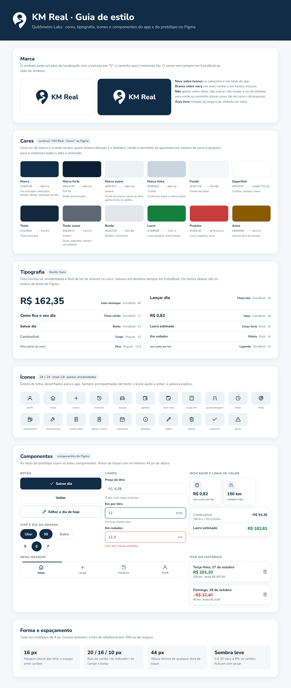

# Guia de estilo

Identidade visual do KM Real: marca, cores, tipografia, ícones e componentes. É a mesma base usada no app (`frontend/src/styles.css`) e no [protótipo no Figma](https://www.figma.com/design/WvEst2KBErrDpuNFzeXu67).

## Princípios

- **O dinheiro é o destaque.** Uma cor de marca (navy) e o resto neutro. Verde e vermelho só aparecem em valores de lucro e prejuízo.
- **Leitura de relance.** O motorista olha o app no carro, entre uma corrida e outra: números grandes, em ExtraBold, e poucas informações por cartão.
- **Celular primeiro.** Tela de referência com 390 px, áreas de toque com no mínimo 44 px e ações principais ao alcance do polegar (menu e botão de salvar fixos no rodapé).
- **Conta aberta.** Todo valor calculado mostra de onde veio (por exemplo, "180 km × R$ 0,52/km").

## Cores

| Nome | Hex | Variável CSS | Uso |
|---|---|---|---|
| Marca | `#102C46` | `--marca` | Cabeçalho, botões, títulos, destaque do dia |
| Marca forte | `#0A1F33` | `--marca-forte` | Botão pressionado |
| Marca suave | `#EDF2F7` | `--marca-suave` | Fundo de ícones, caixas de dica |
| Marca linha | `#C9D5E1` | `--marca-linha` | Contornos sobre a marca suave |
| Fundo | `#F5F7FA` | `--fundo` | Fundo das telas |
| Superfície | `#FFFFFF` | `--superficie` | Cartões, campos, menu |
| Texto | `#13283C` | `--texto` | Texto principal |
| Texto suave | `#5E6872` | `--texto-suave` | Dicas, legendas, rótulos secundários |
| Borda | `#E1E7ED` | `--borda` | Bordas e divisórias |
| Lucro | `#15803D` | `--lucro` | Lucro positivo, meta batida |
| Prejuízo | `#C93C3C` | `--prejuizo` | Lucro negativo, erros |
| Aviso | `#8A5A00` | `--aviso` | Valores que parecem digitados errado |

## Tipografia

Família única: **Nunito Sans**.

| Estilo | Peso · tamanho | Onde |
|---|---|---|
| Valor destaque | ExtraBold · 40 | Lucro de hoje |
| Título tela | ExtraBold · 18 | Cabeçalho |
| Título cartão | ExtraBold · 17 | Título dos cartões |
| Valor | ExtraBold · 18 | Valores dos indicadores e totais |
| Botão | ExtraBold · 15 | Texto dos botões |
| Corpo forte | Bold · 15 | Datas, totais |
| Corpo | Regular · 15 | Texto geral, valores dos campos |
| Rótulo | Bold · 14 | Rótulo dos campos |
| Dica | Regular · 12,5 | Texto de ajuda abaixo dos campos |
| Legenda | SemiBold · 12 | Legendas, menu inferior |

## Ícones

21 ícones de linha desenhados para o app: grade de 24 × 24, traço de 1,8 e pontas arredondadas. Ficam em `frontend/src/components/icon-paths.js` e, no Figma, como componentes `Ícone/...`. Sempre acompanhados de texto.

## Componentes

Botão (primário, secundário, claro), campo (com prefixo, sufixo e dica), chip de app, dia da semana, indicador, linha de valor, item do histórico, menu inferior, seletor segmentado e combustível do dia. No Figma, todos são componentes com propriedades editáveis, e as telas do protótipo usam só eles.

## Forma e espaçamento

- Espaçamentos em múltiplos de 4 px; margem lateral e espaço entre cartões de 16 px.
- Raios: 20 px (cartão), 16 px (indicador), 10 a 12 px (campo e botão), pílula para chips.
- Sombra leve: `0 6px 20px` navy a 6%.

Para alterar a imagem, edite `guia-de-estilo.html` (abre no navegador depois de `npm install`) e tire um novo print da página.
