# Telas em alta fidelidade

## Protótipo no Figma

**[Abrir o protótipo no Figma](https://www.figma.com/design/WvEst2KBErrDpuNFzeXu67)**

Na página "KM Real" ficam:

- **Componentes**: ícones, logo, botão, campo, chip, dia da semana, indicador, linha de valor, item do histórico, menu inferior, seletor segmentado e bloco do combustível do dia, todos ligados às variáveis de cor e aos estilos de texto do [guia de estilo](../guia-de-estilo/).
- **9 telas do celular (390 px)**: boas-vindas (passos 1 e 2), início, lançar dia, histórico, perfil e veículo, ajuste do combustível no dia, lista de abastecimentos e registro de abastecimento. O carro de exemplo é flex: gasolina e etanol aparecem nas boas-vindas, no perfil, no lançamento do dia e no fechamento do mês.
- **Protótipo navegável** com dois fluxos: **Primeiro acesso** (começa nas boas-vindas) e **Uso diário** (começa no início). O menu inferior e a barra de salvar ficam fixos enquanto a tela rola. Em Lançar dia, "Ajustar" abre o ajuste do combustível; no Histórico, "Abastecimentos" leva à lista e "Registrar abastecimento" ao formulário. Para testar, clique em ▶ (Present).

## Telas do app funcionando

Prints do app rodando com os dados de exemplo (`npm run seed`). As telas do Figma seguem o mesmo layout, incluindo o combustível.

### Celular

| Boas-vindas 1 | Boas-vindas 2 | Início |
|---|---|---|
| 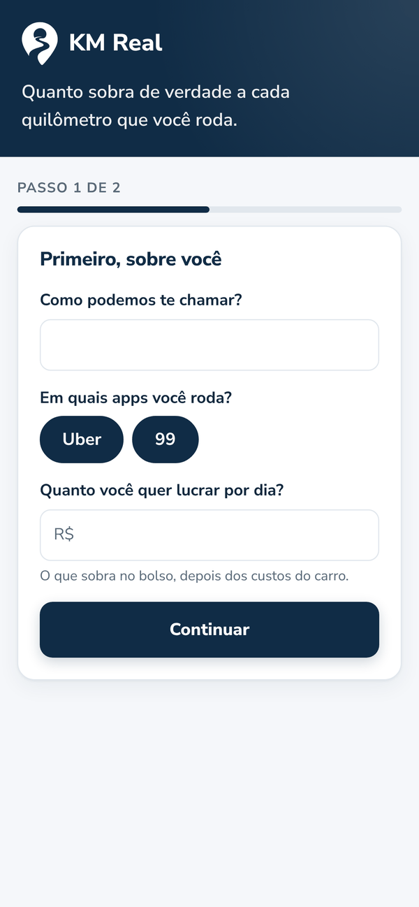 | 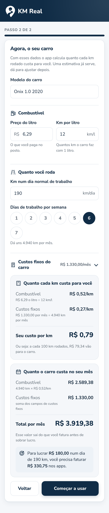 | 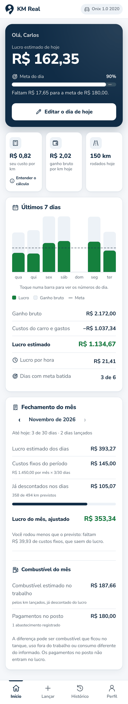 |

| Lançar dia | Histórico | Perfil e veículo |
|---|---|---|
| 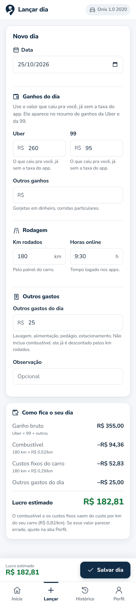 | 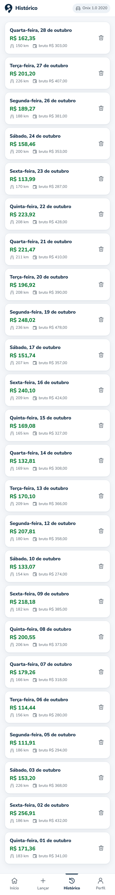 | 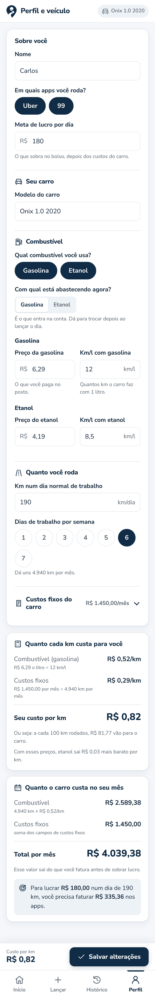 |

Outros estados: [entender o cálculo](cel-04-inicio-entender-calculo.png) · [dia selecionado no gráfico](cel-05-inicio-dia-selecionado.png) · [custos fixos abertos](cel-09-perfil-custos-abertos.png)

#### Combustível

| Ajustar o combustível do dia | Abastecimentos | Registrar abastecimento | Combustível no fechamento do mês |
|---|---|---|---|
| 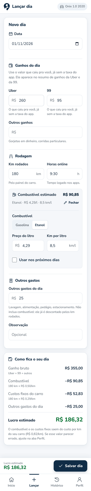 | 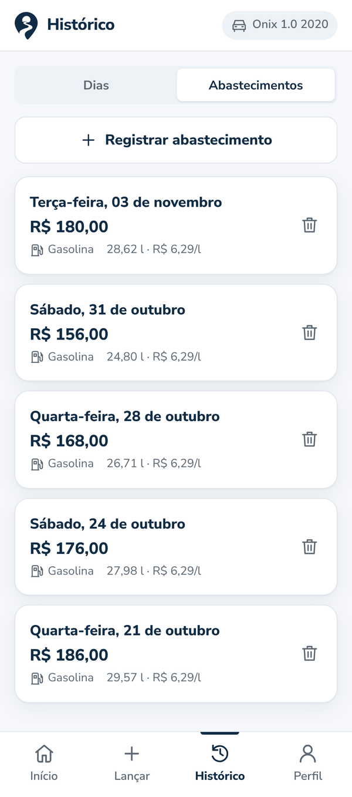 | 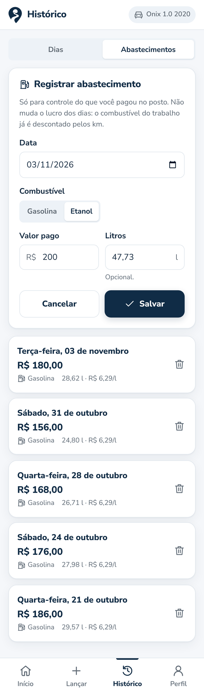 | 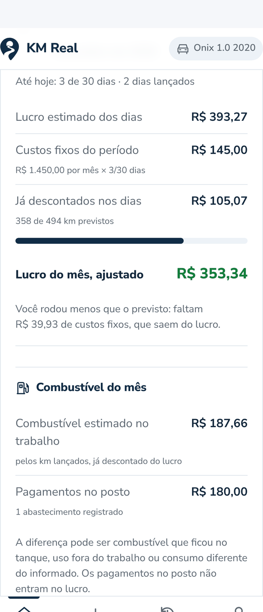 |

O carro pode usar gasolina, etanol ou os dois (cada um com preço e consumo, no cadastro e no Perfil). Ao lançar o dia, o motorista ajusta o combustível só daquele dia ou como novo padrão. Os abastecimentos são só controle: no fechamento do mês aparecem ao lado do combustível estimado, sem mudar o lucro.

### Computador

| Início | Lançar dia |
|---|---|
| 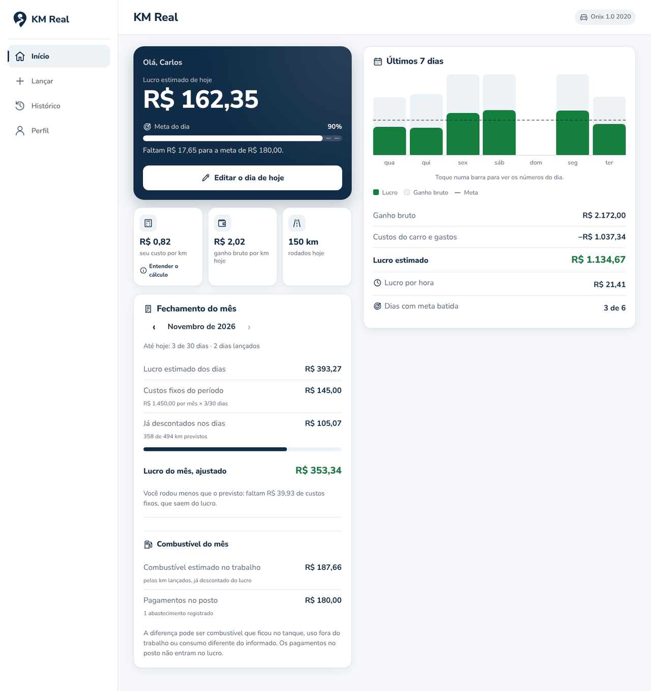 | 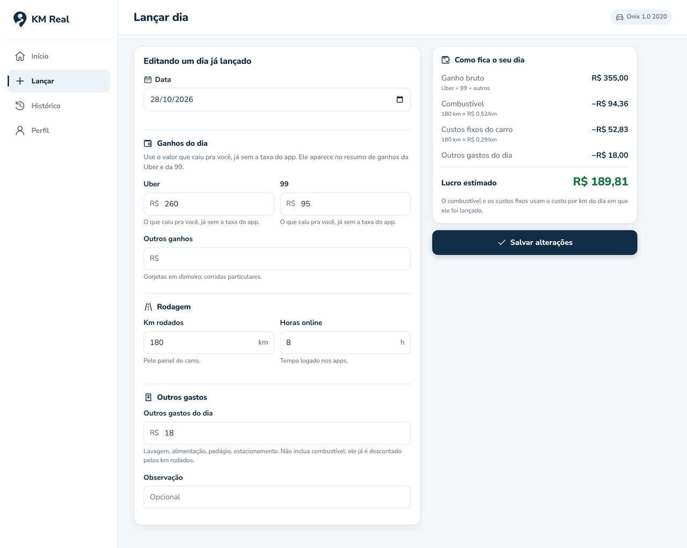 |

| Perfil | Boas-vindas |
|---|---|
| 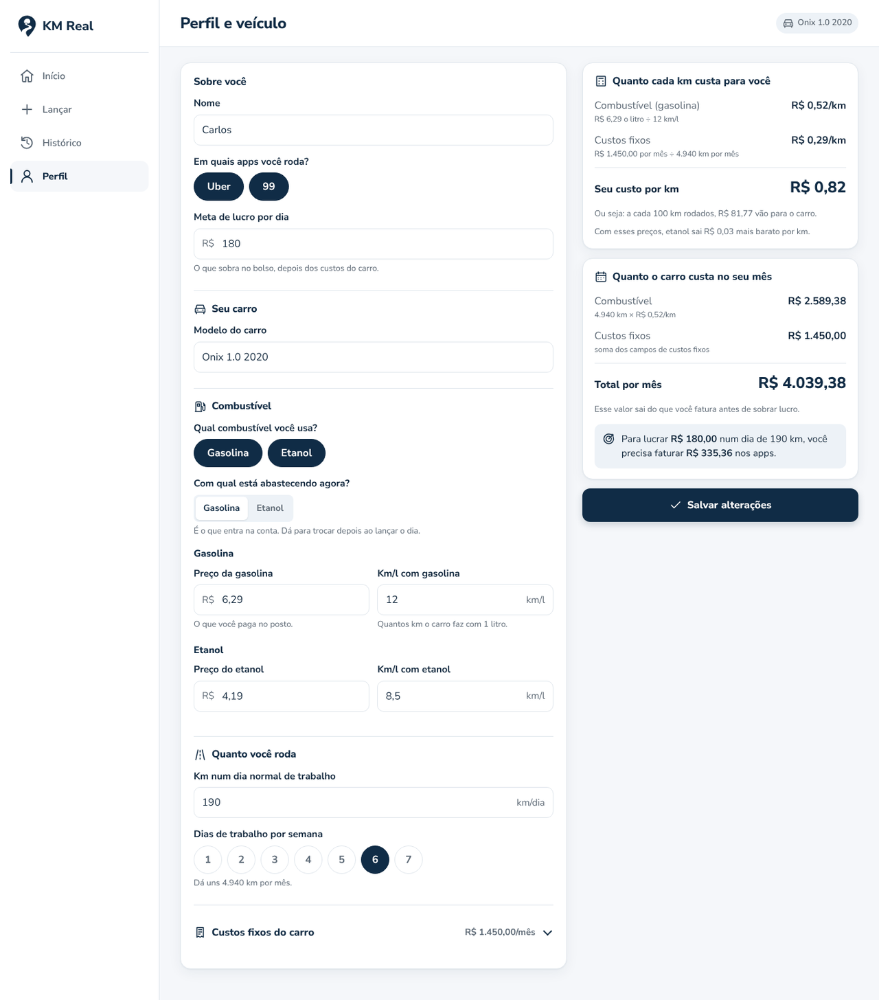 | 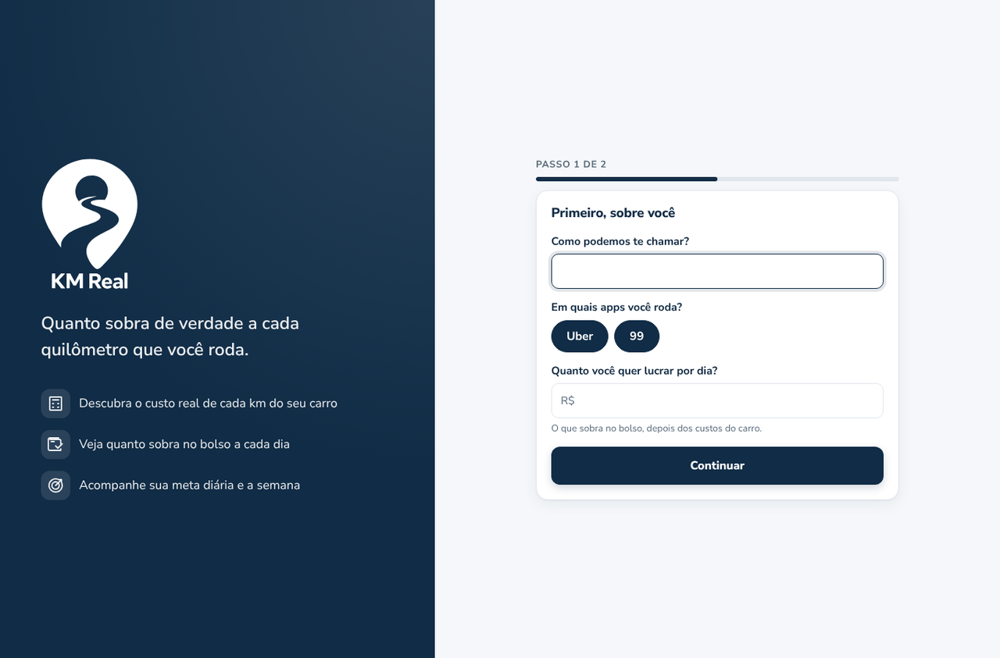 |

## Evolução

1. [Wireframes de baixa fidelidade](../wireframes/): estrutura e fluxo, sem identidade visual.
2. [Guia de estilo](../guia-de-estilo/): cores, tipografia, ícones e componentes.
3. Protótipo de alta fidelidade no Figma e o app funcionando (esta página).
