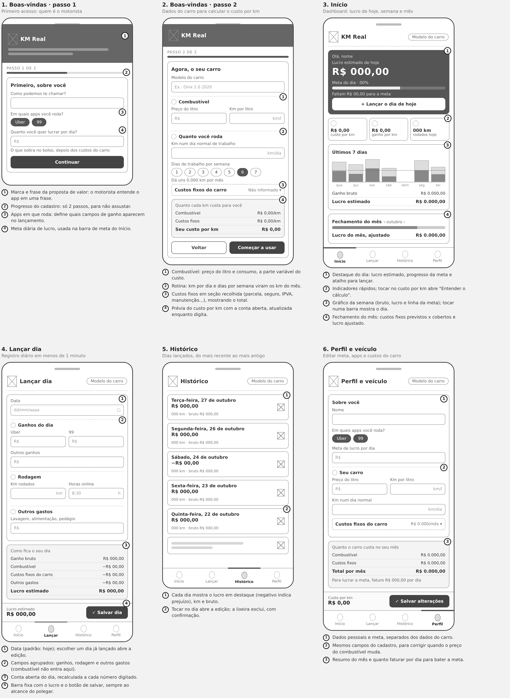

# Wireframes (baixa fidelidade)

Estrutura das telas do KM Real no celular, sem cores nem identidade visual: só a organização das informações e do fluxo. Os números em cada tela correspondem à legenda abaixo dela.

| Tela | Arquivo | O que resolve |
|---|---|---|
| 1. Boas-vindas, passo 1 | [01-boas-vindas-passo-1.png](01-boas-vindas-passo-1.png) | Quem é o motorista: nome, apps e meta diária |
| 2. Boas-vindas, passo 2 | [02-boas-vindas-passo-2.png](02-boas-vindas-passo-2.png) | Dados do carro e prévia do custo por km |
| 3. Início | [03-inicio.png](03-inicio.png) | Lucro de hoje, semana e fechamento do mês |
| 4. Lançar dia | [04-lancar-dia.png](04-lancar-dia.png) | Registro diário com a conta aberta |
| 5. Histórico | [05-historico.png](05-historico.png) | Dias lançados, edição e exclusão |
| 6. Perfil e veículo | [06-perfil-e-veiculo.png](06-perfil-e-veiculo.png) | Ajustar meta, apps e custos do carro |

Convenções: quadrado com X = imagem ou ação (logo, lixeira); círculo tracejado = ícone; barras cinza = texto; caixa escura = destaque.

Para alterar, edite `wireframes.html` (abre em qualquer navegador) e gere as imagens de novo com uma captura de tela de cada bloco.
